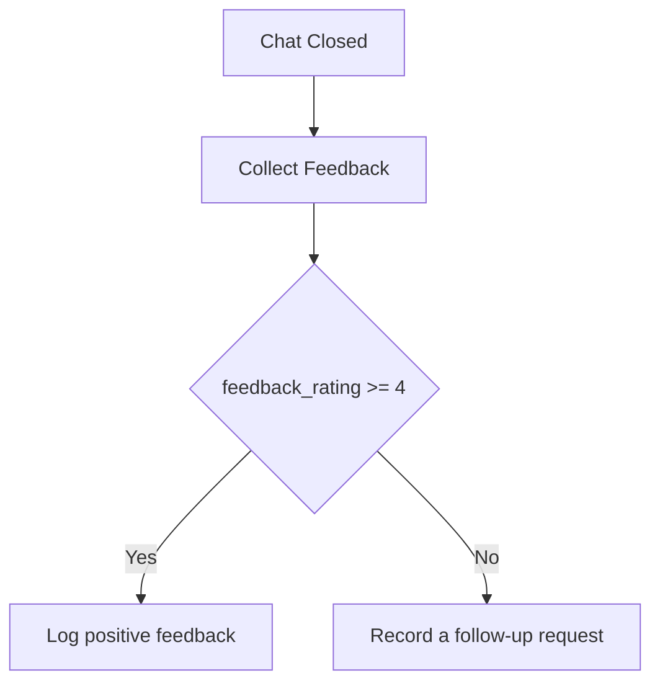

# Chat Closed and Collect Feedback — version 0.14.0

Use the permanent **Chat Closed** trigger together with **Collect Feedback** to gather a rating, survey answers, or both after a conversation ends. Submitted values are saved in chat variables before the following actions run.

Add the Ready **Close chat** action to an ordinary workflow to close automatically and invoke Chat Closed. The tester also exposes **Test an event → Chat closed (live-agent event) → Run event** to simulate a live agent closing the chat. Livechats/Inbox controls and published-channel delivery are later milestones. Chat timeout is a separate event and does not invoke Chat Closed unless its workflow explicitly runs Close chat. See [CLOSE_CHAT.md](CLOSE_CHAT.md).

## Permanent trigger and available actions

Chat Closed is always enabled, top-level only, and cannot be deleted, disabled, duplicated, or nested. Open **AI agents → Workflows → Chat closed → Add action** to configure its actions.

| Allowed action | Availability |
| --- | --- |
| Collect Feedback | Ready; rating, survey, or both |
| Create Ticket | Later |
| Jump | Ready; automatic post-conversation destinations only |
| Branch | Ready |
| Set Variable | Ready |
| Switch Language | Ready |
| Send API | Ready |
| LLM Processing | Later |
| Auto Fill Field | Later |
| Auto Team Match | Later |
| SQL Query | Ready |
| Send Graph | Later |
| Close Chat | Ready; continues without closing again when already closed |

Send message, Send attachment, Show carousel, Ask survey, and incoming triggers cannot be placed under Chat Closed. The policy covers every descendant, disabled step, Branch path, and API/SQL outcome. Jump destinations are checked through their descendants, following siblings, enclosing continuations, all outcome paths, and chained Jumps. The picker explains unavailable destinations, and the backend enforces the same rules. Normal conversations cannot Jump into Chat Closed steps.

Collect Feedback uses a dedicated feedback form while the chat stays closed. Its own questions and configured submission confirmation are part of feedback collection; they do not enable ordinary chat replies or incoming workflow waits.

## Complete rating and optional-comment example

Add **Flow control → Collect feedback**, then fill its tabs:

| Tab | Setting | Example |
| --- | --- | --- |
| Rating | Enable rating | On |
| Rating | Webchat rating title | `How did we do?` |
| Rating | Rating request message | `How would you rate your conversation?` |
| Rating | Set chat variable | `feedback_rating` |
| Survey | Enable survey | On |
| Survey | Question | `Any other comments?` |
| Survey | Required field | Off |
| Survey | Reply type | Open response |
| Survey | Webchat field placeholder | `Please share your comments` |
| Survey | Create variable | `feedback_comment` |
| Settings | Feedback submission text | `Thank you for your feedback!` |

Save, restart the tester, and run **Chat closed**. Select a rating, optionally enter a comment, and press **Submit feedback**. The chat remains Closed. The result contains an integer `feedback_rating` and a text `feedback_comment` (or `None` when the optional comment is blank).

To route the submitted result, add a **Branch after Collect Feedback** with condition `feedback_rating >= 4`. Its If and Else paths can contain data actions such as Set Variable or Send API:

A Send API action after feedback can use Python payload `{"rating": feedback_rating, "comment": feedback_comment}`. Configure your own HTTPS endpoint and authentication. No business service is bundled with this example.

## Execution order

Actions before Collect Feedback run when closure occurs. Collect Feedback issues a form and pauses its children and remaining workflow actions. A successful submission stores the rating/answers, then resumes those children and following steps in order, including Branch/API/SQL/Jump continuations. Multiple Collect Feedback actions issue only one request per conversation; later ones are skipped after submission.

Place a closure log or API call **before Collect Feedback** when it must run even if the customer never submits feedback. Put actions that need the collected variables **after it**. This is a behavior change from the rating-only 0.12.0 implementation, which continued immediately.

The optional, existing **Collect feedback trigger** remains a separate receiving event. It runs once after the resumed post-close actions complete and can process the saved answers. The action and trigger share `type:"collect_feedback"` and are distinguished by `kind`. A separate receiving trigger is unnecessary for the standard example: configure the acknowledgement in **Settings**, and put data actions after the Collect Feedback action. Without a receiving trigger, no generic fallback runs.

## Lifecycle and compatibility

Closure is committed before automation, cancels active surveys/waits, and disables normal messages and old quick replies. Both workflow and older direct-model tester endpoints reject further ordinary messages. Issued feedback has a conversation-owned, one-use token. Invalid submissions preserve the token and do not partially store the rating or answers. Accepted feedback is committed before its subsequent automation; a later failure leaves the chat closed and the answers saved, reports `automation_error`, and does not permit another submission. External side effects cannot be undone and are not automatically retried.

The issued form snapshots its questions, language, variable names, and remaining workflow position. If the workflow changes before submission, the original answers are still accepted and saved; the stale continuation is stopped with a visible diagnostic. Existing 0.12.0 pending rating requests are accepted without replaying actions that previously ran. Older conversational steps under Chat Closed must be removed or relocated before saving.

State remains in PostgreSQL `agent_conversations.workflow_state`, including close time/actor/source, the pending form and private continuation, submitted variables, rating, confirmation, and automation status. Tester closures record `close_source:"tester"`. No migration or dependency is added; **schema head remains 0007**. Preserve `.env` and the database, replace source, and restart backend/frontend. Older installations still need their existing migrations applied from backend with `python -m alembic upgrade head`.

See [COLLECT_FEEDBACK.md](COLLECT_FEEDBACK.md) for all fields, localisation, channel previews, limits, and survey-only configuration; see [API.md](API.md) for the client contract. Reporting screens, Livechats, published channels, and billing are separate milestones.
